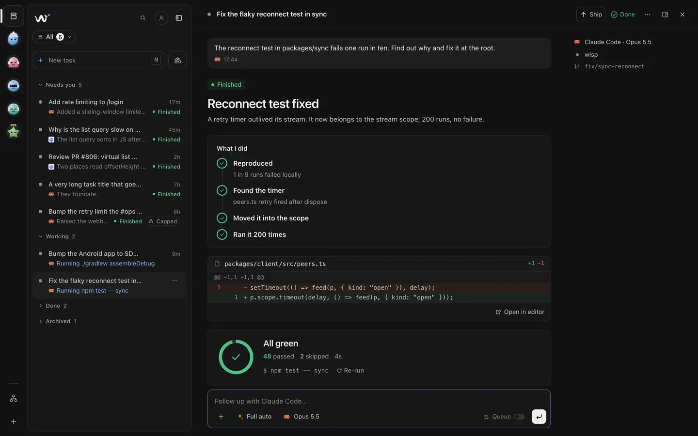

<div align="center">


# wisp

**Manage the code your agents write.**

Declare your coding agents as code. Run them anywhere, many at once. Track every line they write, right next to your
code. From the desktop app, the terminal UI, the command line or your phone.

[](https://www.npmjs.com/package/wisp-agents)
[](#license)
[](https://trywisp.dev/app.html)
[](https://trywisp.dev/agents/)

[Website](https://trywisp.dev/) · [Docs](https://trywisp.dev/docs/) · [Guides](https://trywisp.dev/docs/guides/) · [Get the app](https://trywisp.dev/app.html) · [wisp Cloud](https://trywisp.dev/cloud.html) · [Changelog](https://trywisp.dev/changelog.html)



</div>

---

## What it is

wisp runs the coding agents you already use, **Claude Code, Codex, Cursor CLI, opencode, GitHub Copilot CLI, Grok
Build and Antigravity**, signed in with your own plans and keys. It adds what you need once agents write much of the
code:

- **Declare.** Your agents, crew, machines, skills, MCP servers, rules and workflows as files in your repo's `.wisp/`
  folder. `wisp plan` shows what changes, `wisp apply` makes it so. Review your team in a pull request.
- **Run.** Any agent, many at once, each task in its own git worktree, on this computer, your other computers or in the
  cloud. Follow up, set a goal with judges, compare two agents, ship the pull request.
- **Track.** Every task is kept next to the code it wrote. `wisp blame` tells you which task wrote a line and what it
  was asked; `wisp resume` picks last month's task up on today's code.

Everything works four ways, the **desktop app**, the **phone app**, the **TUI** and the **CLI**, and from your own
agent through wisp's MCP tools.

## Quick start

You need at least one coding agent installed and signed in (`claude`, `codex`, `cursor-agent`, `opencode`, `copilot`,
`grok` or `agy`). Then:

```sh
npx wisp-agents                            # try it: opens the desktop app (or the browser)
npm install -g wisp-agents                 # or install the wisp command (Node.js 18+)
wisp "fix the flaky auth test"             # a task in this folder, in its own worktree
wisp tui                                   # the terminal UI
```

Other ways in:

```sh
curl -fsSL https://trywisp.dev/install.sh | bash   # macOS or Linux
brew install wispagents/tap/wisp-agents            # Homebrew: the command line
brew install --cask wispagents/tap/wisp            # Homebrew: the desktop app (macOS 13.3+)
```

wisp is in alpha: expect rough edges, and [tell us what breaks](https://github.com/WispAgents/wisp/issues).

Next: [your first task](https://trywisp.dev/docs/start/first-task/) · [give your repo a `.wisp/` folder](https://trywisp.dev/docs/start/your-repo/).

## Apps

**Desktop app** for macOS, Windows and Linux. No Node needed, and it updates itself.

| macOS | Windows | Linux |
|---|---|---|
| [Apple silicon](https://github.com/WispAgents/wisp/releases/latest/download/wisp-mac-arm64.dmg) · [Intel](https://github.com/WispAgents/wisp/releases/latest/download/wisp-mac-x64.dmg) | [x64](https://github.com/WispAgents/wisp/releases/latest/download/wisp-windows-x64-setup.exe) · [Arm](https://github.com/WispAgents/wisp/releases/latest/download/wisp-windows-arm64-setup.exe) | .deb: [x64](https://github.com/WispAgents/wisp/releases/latest/download/wisp-linux-x64.deb) · [Arm](https://github.com/WispAgents/wisp/releases/latest/download/wisp-linux-arm64.deb) — AppImage: [x64](https://github.com/WispAgents/wisp/releases/latest/download/wisp-linux-x64.AppImage) · [Arm](https://github.com/WispAgents/wisp/releases/latest/download/wisp-linux-arm64.AppImage) |

Every build is on the [latest release](https://github.com/WispAgents/wisp/releases/latest), with `SHA256SUMS.txt`. The
builds aren't signed yet: on macOS, `curl -fsSL https://trywisp.dev/install.sh | bash -s -- --app` installs the app
without the warning; from a `.dmg`, use System Settings → Privacy & Security → *Open Anyway*. On Windows, SmartScreen →
*More info* → *Run anyway*.

**Phone apps** for iPhone and Android are next. [Join the waitlist](https://trywisp.dev/app.html#phone) and we email
you once, when yours is out. Today, open your cloud wisp, or a computer you put on the Grid, in your phone's browser
and add it to your Home Screen.

**Release channels:** stable (`wisp-agents`), beta (`wisp-agents@next`) and nightly (`wisp-agents@nightly`, a build of
`main` every night its full suite passes). Pick one in Settings → General → Updates.

## Four ways in

| | Desktop app | Phone app | TUI (`wisp tui`) | CLI |
|---|---|---|---|---|
| Start a task | **New task** (<kbd>N</kbd>) | **New task** | <kbd>n</kbd> | `wisp "…" --agent codex` |
| Follow up | the reply box (<kbd>/</kbd>) | the reply bar | <kbd>i</kbd> | `wisp reply <id> "…"` |
| Answer a question | its buttons | its buttons | <kbd>1</kbd>–<kbd>9</kbd>, <kbd>y</kbd> <kbd>a</kbd> <kbd>n</kbd> | `wisp reply <id> "…"` |
| Set a goal | `/goal …`, or ⋯ → Task options › Set goal… | `/goal …`, or the reply bar's options → Goal | `/goal set --text "…"` | `wisp goal set <id> "…"` |
| Ship the PR | **Ship** (<kbd>S</kbd>) | ⋯ → **Ship it…** | `/ship ship` | `wisp ship <id>` |
| The changes | side panel → **Changes** (<kbd>D</kbd>) | the **Changes** pill | <kbd>d</kbd> | `wisp show <id>` |
| Your crew | the rail, and **Org** | the **Crew** tab | <kbd>g</kbd> <kbd>c</kbd> | `wisp crew` |
| Why is this line here? | <kbd>⌘K</kbd> → **Repo history** | | <kbd>g</kbd> <kbd>h</kbd> | `wisp blame file:line` |
| Every command | <kbd>⌘K</kbd> | | <kbd>Ctrl-K</kbd> | `wisp help` |

The browser (`wisp --browser`, or your cloud wisp) is the desktop app's window, menus and keys.

Your own agent drives wisp too: `wisp skill install --agent claude` gives Claude Code wisp's MCP server and skill in
this repo (`--agent codex`, `--agent all`). See [MCP from your harness](https://trywisp.dev/docs/guides/run/mcp-from-your-harness/).

## Guides

- **Start with your agent:** [Claude Code](https://trywisp.dev/docs/guides/agents/claude-code/) · [Codex](https://trywisp.dev/docs/guides/agents/codex/) · [Cursor](https://trywisp.dev/docs/guides/agents/cursor/) · [opencode](https://trywisp.dev/docs/guides/agents/opencode/) · [Copilot](https://trywisp.dev/docs/guides/agents/copilot/) · [Grok](https://trywisp.dev/docs/guides/agents/grok/) · [Antigravity](https://trywisp.dev/docs/guides/agents/antigravity/)
- **Declare:** [build a software factory as code](https://trywisp.dev/docs/guides/declare/software-factory-as-code/) · [share skills, AGENTS.md files and MCP servers with your team](https://trywisp.dev/docs/guides/declare/share-skills-and-mcps/)
- **Run:** [run and follow up](https://trywisp.dev/docs/guides/run/run-and-follow-up/) · [compare and try it two ways](https://trywisp.dev/docs/guides/run/compare-and-try/) · [worktrees and shipping](https://trywisp.dev/docs/guides/run/worktrees-and-shipping/) · [goals and judges](https://trywisp.dev/docs/guides/run/goals/) · [review by another agent](https://trywisp.dev/docs/guides/run/review-by-another-agent/) · [crew and check-ins](https://trywisp.dev/docs/guides/run/crew-and-check-ins/) · [automations and triggers](https://trywisp.dev/docs/guides/run/schedules-and-triggers/) · [Slack, Linear, Telegram and more](https://trywisp.dev/docs/guides/run/from-slack-and-linear/) · [long threads](https://trywisp.dev/docs/guides/run/long-threads/) · [machines, the Grid and wisp Cloud](https://trywisp.dev/docs/guides/run/machines/) · [budgets and usage](https://trywisp.dev/docs/guides/run/budgets-and-usage/)
- **Track:** [track your agents' work beside your code](https://trywisp.dev/docs/guides/track/track-agent-work/)
- **Make it yours:** [plugins](https://trywisp.dev/docs/plugins/make-wisp-your-own/) · [import a wisp home](https://trywisp.dev/docs/migrate/import/)
- **Reference:** [every CLI command](https://trywisp.dev/docs/reference/cli/), setting, MCP tool and resource kind, generated from the code.

## wisp Cloud

[grid.trywisp.dev](https://grid.trywisp.dev): sign in with GitHub or Google and get your own wisp on a server. Your
agents keep working when your laptop sleeps, and `wisp computer on` puts your own computers on it too, reachable from
any browser with no SSH or open ports. Run the same service for your team on your own server with `wisp grid serve`.
[More](https://trywisp.dev/cloud.html).

## Speed

One Rust binary runs the server, the CLI, the TUI and the built-in plugins; a small Solid app sits on top. Measured on
19 November 2026 on an Apple M2 with `spikes/server-budgets` (`wisp serve` in its release build, 5,000 seeded tasks,
fake agents; medians of 5 rounds):

| | measured | budget |
|---|---:|---:|
| cold start → first answer | 54.6 ms | 150 ms |
| first page of the task list | 0.95 ms | 5 ms |
| an agent's step reaching 4 clients, 10 tasks running (p99) | 103.3 ms | 150 ms |
| memory at rest | 101.7 MB | 120 MB |

The app's first screen loads 172.6 KB of JavaScript on desktop and 166.1 KB as the phone app (brotli, `node
tools/budgets.ts` on a fresh build). CI fails a pull request that goes over 173 KB and 167 KB; the goal is 120 KB
(ADR-0011, ADR-0105). The server budgets above are gated in CI too, on Linux.

## Privacy and telemetry

Your prompts, code, file paths and agents' output never leave your machines; they go only to the agents you run, under
your own accounts. wisp sends anonymous usage counts (versions, which agents, task durations and token counts) to
PostHog. Turn them off in Settings → *Anonymous usage stats*, or with `WISP_TELEMETRY=0` or `DO_NOT_TRACK=1`; they're
always off in CI. The full policy: [trywisp.dev/privacy.html](https://trywisp.dev/privacy.html).

## Develop

[docs/dev.md](docs/dev.md) takes you from clone to a running, debuggable wisp, with one test per area.

```sh
npm install            # the TypeScript (UI) workspaces
npm run doctor         # is this checkout ready?
npm run dev            # wisp serve from this checkout on :4800, with the web app hot-reloading
npm run dev:desktop    # the same in the desktop window
```

Read [AGENTS.md](AGENTS.md) for the rules every change follows, [ARCHITECTURE.md](ARCHITECTURE.md) for the map of
the code and [docs/adr/](docs/adr/) for why each decision was made. Rust for everything but the UI; TypeScript and
Solid for the UI; everything is a plugin. To add a coding agent, see [Build plugins](https://trywisp.dev/docs/plugins/first-plugin/).

The website (`trywisp.dev`) is generated by `scripts/site.mjs`; the docs (`trywisp.dev/docs`) are `apps/docs` over
`docs/site`.

## Contributing

Issues and pull requests are welcome. Work on a branch, keep to [AGENTS.md](AGENTS.md), and add a `CHANGELOG.md` entry
under *Unreleased* for anything users see.

## License

[MIT](LICENSE) © M0xoo
